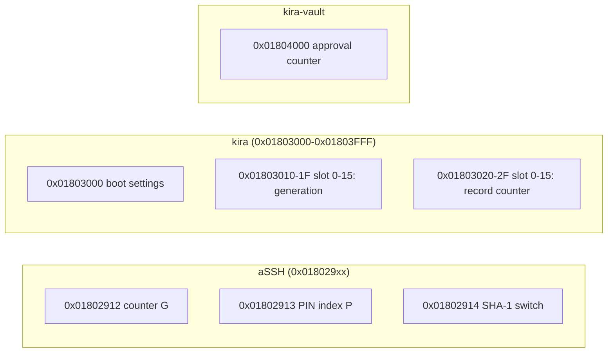

# NV indices: what kira, kira-vault and aSSH keep in the TPM

Every NV index the three define, by its handle. None of them keeps a persistent
object (`0x81…`): every key is loaded for its use and flushed after it.

| Index | Project | Kind | What it is for | Written by |
|---|---|---|---|---|
| `0x01802912` | aSSH | NV counter (G) | the SSH CA's approvals: every approval names a value of G; raising it revokes the approvals of the values before | `NV_Increment` with the CA's PIN |
| `0x01802913` | aSSH | NV counter (P), its authValue the PIN | the CA's PIN index: written once at its making (value k); its PIN guards the CA's authority key and G; the one object of the CA's that the dictionary attack protection guards | once at the making; `NV_ChangeAuth` with the PIN for a PIN change |
| `0x01802914` | aSSH | empty marker | its presence allows SHA-1 on a TPM without an active SHA-256 bank; nothing secret; safearch's initrd reads it too | the owner (`assh tpm sha1`, `--sha1`) |
| `0x01803000` | kira | NV data, signed | the boot settings ("Debug at boot"; `[version][flags]`) | the signing key alone (PolicySigned); `control` |
| `0x01803010` + *n* | kira | NV data (8 bytes) | slot *n*'s **generation index**, at the slot's own handle (slot 0-15): its existence says the slot exists; the approved policy checks it (`PolicyNV(G == n)`), so an older approval no longer opens the slot; noDA | the signing key alone; `slot add`, `slot approve` |
| `0x01803020` + *n* | kira | NV counter | slot *n*'s **record counter**: the record in its EFI variable is fresh, an older copy refused | the signing key alone; the enrolments |
| `0x01804000` | kira-vault | NV counter | the vault's approval counter: each approval raises it and names its new value (`PolicyNV`), so every earlier approval fails in the TPM; noDA; read without authorisation | an approval key alone (PolicySigned, its PIN): nobody else can invalidate the approvals |

## The ranges

- **aSSH**: `0x01802912`-`14`, the defaults of its `--counter-handle` and `--pin-handle`.
- **kira**: `0x01803000`-`0x01803FFF`. `slot delete --yes --sweep` (and `control`'s
  "Delete everything") takes whatever is in that range, and aSSH's handles of the SSH CA
  (`0x01802912`-`15`), shown first and read as nothing (SLOT.md).
- **kira-vault**: `0x01804000`, outside both on purpose: kira's sweep on a vault host
  leaves it alone.

## What is not an NV index

- A slot's **record**: the EFI variable `KIRAslot`*n* (SECURITY-BACKGROUND §3.1).
- kira's **slot objects** (the TOTP key, the machine-id, the boot key, the release key):
  wrapped by the TPM's storage key, in the slot's record.
- aSSH's **SSH CA**: the EFI variable `KIRAasshCA`.
- The vault's **master** and **approval key**: blobs in its `master.json`, loaded under the
  storage primary for one use each (VAULT.md §6.2).

## Places left by earlier versions

Taken by the sweep alone, where they are left: the generation indices at `0x01803810` + *n*
and the record counters at `0x01803820` + *n* (before 2026-11-07), the slots' blobs that were
NV indices before their records moved into EFI variables, and aSSH's window index
`0x01802915`.
